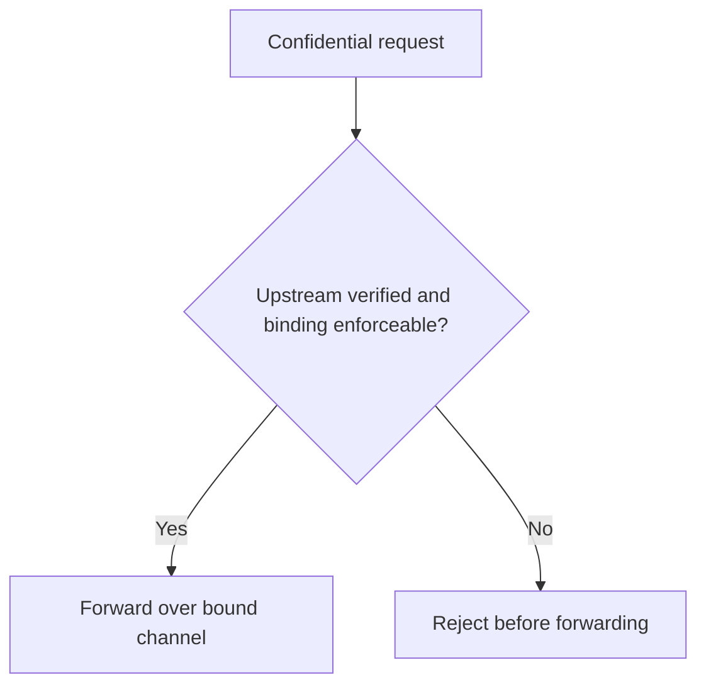

Verifying an upstream's attestation is not enough by itself. The gateway must also prove it sends the prompt to the same verified endpoint. Channel binding closes that gap.

For a confidential response, gateway verification and binding are one fact: if the provider cannot be verified and bound, the prompt is not forwarded.

## Binding Types

| Binding | What it is | How it is enforced |
| --- | --- | --- |
| `tls_spki_sha256` | SHA-256 digest of the upstream TLS public key (SPKI). | The gateway pins the HTTPS connection to that key before forwarding. |
| `e2ee_public_key_sha256` | SHA-256 digest of the upstream E2EE public key. | The gateway encrypts the provider-facing request to the verified enclave key. |
| `proxy_image_sha256` | Privatemode proxy image digest and startup-checked shared credential digest. | The gateway requires the binding to match the measured co-deployed proxy and sends plaintext only to its configured internal origin; the proxy handles provider-facing encryption. |

The binding type depends on the provider. See [Providers](/phala-cloud/confidential-ai/confidential-model/providers).

## Fail-Closed Forwarding

When `upstream.verified.required` is `true`, the gateway must verify the upstream and enforce the binding before forwarding. If verification fails, or if the binding cannot be enforced on the live connection, the gateway rejects instead of sending the prompt.

On the Phala TEE-only endpoint, `required` is `true` for every routed request. A failed verification refuses forwarding; it does not fall back to an unverified provider.

## How to Confirm Binding

You do not enforce the provider binding from your client. You verify that the gateway did:

1. Verify the [Attestation Report](/phala-cloud/confidential-ai/confidential-model/api-reference/attestation).
2. Fetch the [Receipt](/phala-cloud/confidential-ai/confidential-model/api-reference/receipts).
3. Verify the receipt signature and exact request/response `body_hash` values; require `upstream.verified.result: verified`, `required: true`, and a `session_id`.
4. Fetch the full [Session](/phala-cloud/confidential-ai/confidential-model/api-reference/sessions), verify its content address and evidence, and inspect `channel_binding` under your policy.

The [TypeScript SDK](/phala-cloud/confidential-ai/verify/typescript-sdk) and [Private AI Proxy](/phala-cloud/confidential-ai/agents/private-ai-proxy) implement client-side checks. cURL inspection alone does not establish channel binding.

## Related

<CardGroup cols={2}>
  <Card title="Trust Boundary" icon="shield-halved" href="/phala-cloud/confidential-ai/confidential-model/trust-boundary" />
  <Card title="TCB and Claims" icon="list-check" href="/phala-cloud/confidential-ai/confidential-model/tcb-and-claims" />
</CardGroup>
