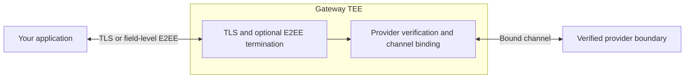

Phala's Attested Confidential Inference (ACI) gateway runs inside an Intel TDX TEE. It publishes an attestation report that binds its keyset to hardware evidence, then signs a receipt that binds each request and response to that keyset.

## Two proof layers

| Artifact | What it establishes | Endpoint |
| --- | --- | --- |
| Attestation report | Gateway workload evidence, nonce freshness, measured compose, key custody, and public keyset | `GET /v1/aci/attestation?nonce=` |
| Signed receipt | Request and response hashes, routing events, and the verified upstream session for one exchange | `GET /v1/aci/receipts/{id}` |

A receipt is meaningful after you establish the gateway's identity and appraise its measurements under your policy. The attestation report tells you which receipt-signing keys belong to the measured workload; a signature alone does not establish successful confidential serving.

## Request flow

1. Your client establishes the gateway identity and pins the connection when using an ACI-aware transport. Ordinary SDK calls only use TLS.
2. The gateway receives your request, decrypts any E2EE fields, and records its hash.
3. The backend verifies an eligible upstream and enforces its channel binding before forwarding. This Phala endpoint always requires verified serving. A failed required check refuses forwarding.
4. The gateway observes the final response bytes and signs a receipt. Retrieve it using `x-receipt-id`, or the response id after completion when the stream committed headers before a receipt id was allocated.

## Upstream sessions

The receipt's `upstream.verified` event must have `result: "verified"`, `required: true`, and a `session_id`. Fetch the cited session to inspect the provider boundary, channel binding, claims, validity window, and evidence. Verify its content address and evidence digest before applying your policy.

A model CVM, router, and broker establish different boundaries. Gateway attestation does not independently prove every provider's model weights, CPU-to-GPU link, or software provenance. See [Providers](/phala-cloud/confidential-ai/confidential-model/providers) and [Trust Boundary](/phala-cloud/confidential-ai/confidential-model/trust-boundary).

## Related

<CardGroup cols={2}>
  <Card title="Verify a response" icon="circle-check" href="/phala-cloud/confidential-ai/verify/typescript-sdk" />
  <Card title="Verified upstreams" icon="link" href="/phala-cloud/confidential-ai/confidential-model/verified-upstreams" />
  <Card title="Receipts and sessions" icon="receipt" href="/phala-cloud/confidential-ai/confidential-model/receipts-and-sessions" />
  <Card title="Attestation report" icon="microchip" href="/phala-cloud/confidential-ai/verify/verify-attestation" />
</CardGroup>
