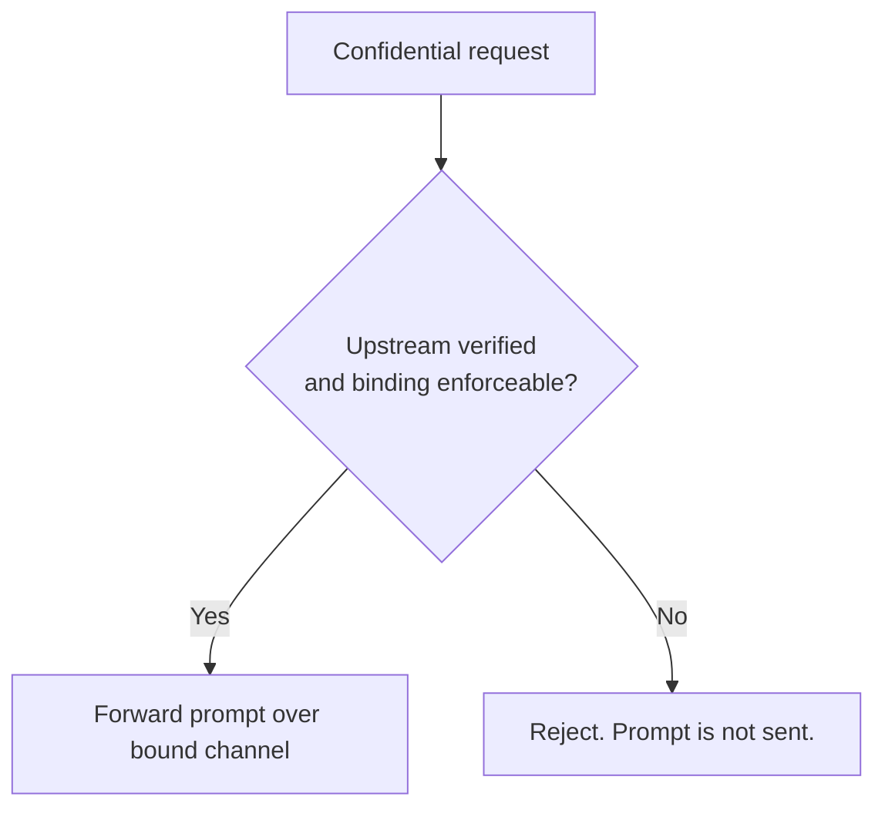

For a confidential model, the gateway verifies the upstream enclave before it sends your prompt, and
refuses to send if it cannot. Verification produces three things: a **channel binding** the gateway
enforces on the wire, an **attested session** it records, and the **typed claims** inside that
session. The receipt's `upstream.verified` event ties a response to all three.

## Channel binding

Verifying an upstream's attestation is not enough on its own: a genuine enclave could exist while
the gateway talks to a different server. Channel binding closes that gap. The value the gateway
verifies is the value it enforces on the connection before forwarding.

| Binding | What it is | How the gateway enforces it |
| --- | --- | --- |
| `tls_spki_sha256` | SHA-256 of the upstream's TLS public key (SPKI). | Pins the upstream HTTPS connection to that key. |
| `e2ee_public_key_sha256` | SHA-256 of the upstream's end-to-end public key. | Encrypts the request body to that key, so only the attested enclave can decrypt it. |
| `proxy_image_sha256` (Privatemode) | `provider`, `proxy_image_digest`, and `credential_sha256` identify a co-deployed proxy and its credential. | Checks the credential and forwards only to the private proxy pinned in the gateway's measured deployment; the proxy verifies and encrypts the provider hop. |

The proxy binding covers the measured proxy deployment, not the specific provider workload that
served a request. An observed provider manifest alone does not establish that workload binding.

Every confidential provider produces exactly one binding, and it lives inside the verified
attestation. A "verified" result without an enforceable binding is rejected in the gateway itself:
a provider can never be verified but unpinned. Which provider uses which binding is on the
[Confidential providers](/phala-cloud/confidential-ai/confidential-model/providers) page.

For a confidential model, `upstream.verified.required` is `true`. If the gateway cannot verify the
upstream or enforce the binding on the actual connection, it does not send your prompt. If the
binding stops matching, the gateway re-verifies before forwarding; retries cannot bypass this.



Every model on this Phala endpoint requires verified serving.

## Attested sessions

When the gateway verifies an upstream, it records an **attested session**: an immutable snapshot of
the verified channel. A session is the channel, not a model. One channel can serve many models, so a
router-backed provider produces one session and the served model is recorded on the receipt. A
session captures:

- the verified upstream identity and endpoint;
- the enforced channel binding;
- the typed claims about the TEE, each with its source; and
- the byte-preserving evidence the verifier checked.

The `session_id` is the SHA-256 of the full session document in canonical JCS form, as 64 lowercase
hex characters. Any change to the document produces a different id, so recomputing the hash proves
the session you fetched is exactly the one the receipt cited.

```text
response  → x-receipt-id
receipt   → upstream.verified { result, required, model_id, session_id }
session   → { binding, claims (+ reasons), evidence }
```

Fetch [`GET /v1/aci/sessions/{session_id}`](/phala-cloud/confidential-ai/confidential-model/api-reference/sessions) for the provider, binding,
claims, and evidence. You do not enforce the binding yourself; you confirm after the fact that the
gateway did: `result` is `verified`, `required` is `true`, and the cited session carries the
binding.

## Claims

A session never says "trusted". It carries a fixed set of claims, each with a `status`, a `source`,
and a plain `reason`, so a hardware-proven fact and an operator's assertion never look alike.

```json
{
"tee_attested": {
  "status": "asserted",
  "source": "hardware_proven",
  "reason": "verified the TEE quote and bound the request channel"
}
}
```

| `status` | Meaning |
| --- | --- |
| `asserted` | The verifier's evidence backs this claim. |
| `refuted` | The evidence contradicts the claim, for example a stale platform TCB. Recorded, not hidden. |
| `unknown` | The claim was not established. Never a silent pass. |

| `source` | Assurance |
| --- | --- |
| `hardware_proven` | From the verified TEE quote or its collateral. Strongest. |
| `verifier_derived` | Computed by the verifier from verified evidence. |
| `provider_asserted` | Published by the provider, not independently proven. |
| `operator_asserted` | Declared by the gateway operator. Weakest. |

| Claim | Asks |
| --- | --- |
| `tee_attested` | Is this a genuine CPU TEE with an identity bound to the channel? |
| `tcb_up_to_date` | Is the platform's Trusted Computing Base current? |
| `os_known_good` | Does the OS or platform image map to reviewed source? |
| `serving_software_known_good` | Does the serving software map to reviewed source? |
| `gpu_attested` | Is a genuine confidential-computing GPU attested and nonce-bound? |
| `model_weights_provenance` | Are the served weights and quantization what they claim to be? |

Two claims need care when you read them:

- `tcb_up_to_date` is read from the verifier's reported TCB status. An up-to-date platform asserts
  it, a stale platform refutes it, and an absent status leaves it `unknown`. Freshness comes from the
  evidence, never from policy.
- `gpu_attested` is `asserted` with source `verifier_derived` when the provider's NVIDIA
  confidential-computing GPU attestation is verified and bound to the nonce. It proves a genuine
  confidential GPU exists for that nonce, not that the GPU is bound to the CPU TEE serving your
  request. The typed claim is supplemental; a provider verifier may still require GPU evidence to accept its own provider boundary.

To use claims in a decision: require `tee_attested` to be `asserted` with source `hardware_proven`;
treat `serving_software_known_good: asserted` as stronger than any `provider_asserted` claim about
software; decide your own policy on `tcb_up_to_date: refuted`; read `gpu_attested` as supplemental;
and treat every `unknown` as not proven. Which provider asserts which claim is on the
[Confidential providers](/phala-cloud/confidential-ai/confidential-model/providers) page.

### Fields to check in `extra`

For a Phala-direct session:

| Field | Expected | Meaning |
| --- | --- | --- |
| `canonical_model_id` | Acceptable model mapping under your policy | **Verify this.** Naming may differ; see [model ids](/phala-cloud/confidential-ai/confidential-model/attested-routing#list-the-models-you-can-use) |
| `tcb_status` | Acceptable under your policy | Platform TCB status reported by quote collateral; `OutOfDate` is not a freshness pass |
| `tdx_debug_mode` | `false` | `true` means debug mode, and confidentiality does not hold |
| `os_image_is_dev` | `false` | Reject development images in production |
| `production_os_image` | `true` | |
| `compose_hash_verified` | `true` | The measured compose matches what was declared |
| `report_data_nonce_matched` | `true` | The upstream evidence matches the upstream verifier's challenge; this is separate from your gateway-attestation nonce |
| `gpu_evidence_nonce_matched` | `true` | GPU evidence is nonce-bound too |
| `tls_spki_from_report_data` | `true` | The TLS channel binding comes from hardware measurement, not a spoken claim |
| `trust_boundary` | `phala-dstack-cvm` | |

Which keys appear in `extra` depends on the upstream provider that served the session, so treat this
list as a starting point rather than a fixed schema.

### Inspecting the images in the measured compose

For a Phala-direct JSON evidence bundle, set `SID` to the session id cited by your receipt:

```bash
curl -fsS "https://inference.phala.com/v1/aci/sessions/$SID" \
  -H "Authorization: Bearer $PHALA_AI_API_KEY" \
| jq -r '.evidence.data' | sed 's|^data:application/json;base64,||' | base64 -d \
| jq -r '[.all_attestations[] | .info.tcb_info | (if type=="string" then fromjson else . end)
          | .app_compose | fromjson | .docker_compose_file] | join("\n")' \
| grep -E 'image:|--served-model-name'
```

## Related

<CardGroup cols={2}>
  <Card title="Confidential providers" icon="server" href="/phala-cloud/confidential-ai/confidential-model/providers">
    Binding type and asserted claims per provider.
  </Card>
  <Card title="Receipts" icon="receipt" href="/phala-cloud/confidential-ai/confidential-model/receipts-and-sessions">
    The `upstream.verified` event that cites a session.
  </Card>
  <Card title="Session endpoint" icon="link" href="/phala-cloud/confidential-ai/confidential-model/api-reference/sessions">
    Fetch a session by id, or list current sessions.
  </Card>
  <Card title="Trust boundary" icon="shield-halved" href="/phala-cloud/confidential-ai/confidential-model/trust-boundary">
    What the gateway does and does not protect.
  </Card>
</CardGroup>
