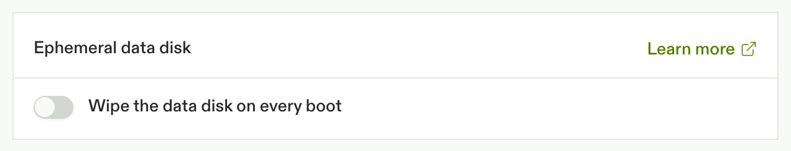
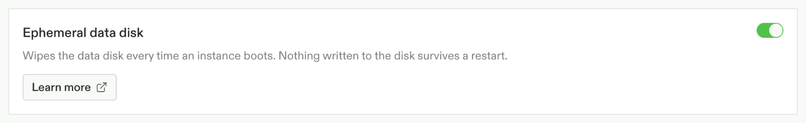

<Info>
  Needs dstack OS 0.6.3 or newer. dstack OS 0.5.x does not support it. See [Requirements](#requirements) for the CLI and SDK versions.
</Info>

Every CVM has one data disk. It is the only place a CVM keeps files. Your container images, your containers, your Docker volumes and anything else your app saves are all on it. Normally the disk keeps all of this when the CVM restarts.

With an ephemeral data disk, the CVM wipes that disk each time it starts, before any of your code runs. Every start begins with a clean, empty disk. Use it when no data may stay on the disk from one start to the next.

This page calls each start of the CVM a boot.

## How it works

The setting is one field in your app compose:

```json
{ "requirements": { "ephemeral_data_disk": true } }
```

When it is `true`, the CVM sets its data disk up again as a new, empty encrypted disk at the start of every boot. Docker starts only after that.

It is the same data disk, with the size you chose. No extra disk is added.

### What is wiped

Everything on the data disk:

- Container images
- Containers and the files they wrote
- Docker volumes, including named volumes
- Any other file your app saved, such as model weights, caches and databases

Because the images are wiped too, the CVM downloads every image again on each boot. The larger your images and models, the longer each start takes.

### What stays

These are not stored on the data disk, so they stay the same:

- Your compose and the rest of the CVM's settings
- Your [encrypted environment variables](/phala-cloud/cvm/set-secure-environment-variables). The CVM gets them again on every boot.
- Your app ID and the keys your app gets from the KMS. The CVM asks for them on every boot and gets the same ones.

### When the wipe happens

On every boot. A boot happens when:

- you restart the CVM
- you stop the CVM and start it again
- you update the CVM, because an update restarts it
- you change any other setting that restarts the CVM
- the CVM restarts on its own, for example after a crash or after maintenance on the node

A container that restarts inside a running CVM is not a boot. Its volumes keep their data until the CVM itself boots again.

## Requirements

| What | Version you need |
| --- | --- |
| dstack OS image | 0.6.3 or newer |
| Phala Cloud CLI (`phala`) | 1.2.1 or newer |
| JavaScript SDK (`@phala/cloud`) | 0.5.0 or newer |
| Python SDK (`phala-cloud`) | 0.3.0 or newer |
| Go SDK | v0.3.0 or newer |
| Terraform provider | 0.3.0-beta.5 or newer |

dstack OS 0.5.x does not support the setting. Neither do 0.6.0, 0.6.1 and 0.6.2. If you send it for a CVM on one of these, the request is rejected with `ERR-03-018`.

One thing depends on the API version when you read the setting back. From API version `2026-11-11`, `GET /cvms/{cvm_id}` leaves out `compose_file` unless you add `include_compose=true` to the request. See [API versioning](/phala-cloud/references/cloud-js-sdk/api-versioning).

## Turn it on for a new CVM

A new CVM has no data yet, so you do not need to confirm anything.

### Dashboard

1. Open **Deploy** in your workspace.
2. Go to step 2, **Compute**.
3. Scroll down to the **Ephemeral data disk** card and turn on **Wipe the data disk on every boot**.

<Frame caption="The Ephemeral data disk card in the Compute step">
  
</Frame>

The switch is locked while the operating system you picked is older than dstack OS 0.6.3. Pick 0.6.3 or newer under **Operating system** in the same step, and the switch unlocks.

To check your choice before you deploy, go to step 5, **Review**. The `app-compose.json` shown there has `ephemeral_data_disk` set to `true` under `requirements`.

### CLI

Add `--ephemeral-data-disk` to [`phala deploy`](/phala-cloud/phala-cloud-cli/deploy):

```bash
phala deploy -c docker-compose.yml --ephemeral-data-disk
```

### API and SDKs

Set the field in `compose_file.requirements` on the create request (`POST /cvms`):

```json
{
  "compose_file": {
    "requirements": { "ephemeral_data_disk": true }
  }
}
```

Send the value `true` without quotes. The text `"true"` is rejected with a 422 validation error.

The SDKs send the same field. Put it in the `requirements` of the compose file you pass when you create the CVM. With Terraform, set it in the `requirements` block of [`phala_app`](/phala-cloud/references/terraform-provider/app-resource).

## Turn it on for an existing CVM

Turning it on wipes everything on the data disk, and you cannot get it back. Copy out anything you need first.

### Dashboard

1. Open the app.
2. Go to **App Settings**.
3. In the **Ephemeral data disk** card, turn on the switch on the right.
4. Select **Turn on** in the dialog.

<Frame caption="The Ephemeral data disk card in App Settings, turned on">
  
</Frame>

Running instances restart right away and come back with an empty data disk. Stopped instances stay stopped. Their disk is wiped the next time they start.

If the app has several instances, the dialog lets you choose which ones to change. An instance on a dstack OS older than 0.6.3 cannot be chosen. If every instance is that old, the card says the setting is not supported and the switch is locked.

On Onchain KMS, the dashboard then asks you to sign a transaction that adds the new compose hash to your app contract.

### CLI, API and SDKs

The request must confirm the wipe with `confirm_data_wipe`. The API request is [`PATCH /cvms/{cvm_id}`](/phala-cloud/update/update-cvm-configuration).

<CodeGroup>

```bash CLI
phala deploy --cvm-id <cvm-name-or-id> --ephemeral-data-disk --confirm-data-wipe
```

```json API
{
  "compose": { "requirements": { "ephemeral_data_disk": true } },
  "confirm_data_wipe": true
}
```

```typescript JavaScript
await client.patchCvm({
  id: "my-app",
  compose: { requirements: { ephemeral_data_disk: true } },
  confirm_data_wipe: true,
});
```

```python Python
client.patch_cvm({
    "id": "my-app",
    "compose": {"requirements": {"ephemeral_data_disk": True}},
    "confirm_data_wipe": True,
})
```

```go Go
_, err := client.PatchCVM(ctx, "my-app", &phala.PatchCVMRequest{
	Compose: &phala.ComposePatch{
		Requirements: phala.PatchValue(phala.ComposeRequirementsPatch{
			EphemeralDataDisk: phala.PatchValue(true),
		}),
	},
	ConfirmDataWipe: true,
})
```

</CodeGroup>

A running CVM restarts, and that boot wipes the disk. A stopped CVM stays stopped. Its disk is wiped when you next start it.

[Update CVM Configuration](/phala-cloud/update/update-cvm-configuration) explains the rest of the request, including what happens on Onchain KMS.

### Errors

| Error | Why | What to do |
| --- | --- | --- |
| `ERR-03-048` | The request did not confirm the wipe. Nothing has changed on the CVM. | Send it again with `"confirm_data_wipe": true`, or add `--confirm-data-wipe` in the CLI. |
| `ERR-03-018` | The OS image is too old for the setting. It needs dstack OS 0.6.3 or newer. | Use an OS image that runs dstack OS 0.6.3 or newer. See [Requirements](#requirements). |

## Wipe the disk only once

You can use the setting for a single wipe. This gives a running CVM a clean disk without creating a new CVM.

1. [Turn it on](#turn-it-on-for-an-existing-cvm). The CVM restarts and wipes the disk.
2. Wait until the CVM is running again.
3. [Turn it off](#turn-it-off). The CVM restarts again. From then on the disk keeps what you write to it.

This takes two updates and two restarts. Each update changes the compose hash. To end up with the hash you started with, see [Which compose hash do I get after turning it off?](#which-compose-hash-do-i-get-after-turning-it-off)

With Onchain KMS, every new compose hash must be on your app contract before its update can go through.

## Turn it off

You do not need to confirm a wipe when you turn it off.

### Dashboard

1. Open the app.
2. Go to **App Settings**.
3. In the **Ephemeral data disk** card, turn off the switch on the right.
4. Select **Turn off** in the dialog.

Running instances restart to apply the change. If the app has several instances, the dialog lets you choose which ones to change. On Onchain KMS, the dashboard asks you to sign a transaction that adds the new compose hash to your app contract.

### CLI, API and SDKs

Send the field as `null` with the same `PATCH /cvms/{cvm_id}` request.

<CodeGroup>

```bash CLI
phala deploy --cvm-id <cvm-name-or-id> --no-ephemeral-data-disk
```

```json API
{ "compose": { "requirements": { "ephemeral_data_disk": null } } }
```

```typescript JavaScript
await client.patchCvm({
  id: "my-app",
  compose: { requirements: { ephemeral_data_disk: null } },
});
```

```python Python
client.patch_cvm({
    "id": "my-app",
    "compose": {"requirements": {"ephemeral_data_disk": None}},
})
```

</CodeGroup>

A running CVM restarts. From that boot on, the disk keeps what you write to it. Data from earlier boots does not come back.

### Which compose hash do I get after turning it off?

It depends on what you send. The compose hash covers the whole `requirements` object.

| You send | What is left in the compose | Compose hash |
| --- | --- | --- |
| `"ephemeral_data_disk": null`, and it was the only key | No `requirements` at all | The same as before you turned the setting on |
| `"requirements": null` | No `requirements` at all | The same as a compose that never had `requirements` |
| `"ephemeral_data_disk": false` | `"ephemeral_data_disk": false` | A new hash |

The CLI flag `--no-ephemeral-data-disk` sends `false`.

## What the wipe protects

Your app cannot read data from an earlier boot. The wipe happens before any of your code runs, so the app starts with nothing an earlier boot left behind.

Putting an old disk back does not help either. Suppose the host saved a copy of the disk during an earlier boot and later put it back in place of the current disk. The CVM does not open that copy. It wipes it like any other disk.

The data disk is encrypted, as on every CVM. The key comes from the KMS and is given only to your CVM. The host does not have it.

The wipe has two limits:

- It does not overwrite every block of the disk. It sets the disk up again as a new, empty encrypted disk.
- It does not change the disk key your CVM gets from the KMS. The same CVM gets the same key on every boot.

If you need a new disk key, create a new CVM. A new CVM gets a new key and a new, empty disk.

## Compose hash and verification

The setting is part of your `app-compose.json`, so turning it on or off gives the CVM a new compose hash. Your app ID and your app's keys do not change.

This lets other people check it. The compose hash is in the CVM's attestation, so anyone who verifies your app can read the setting in the compose and know that every boot starts with an empty disk.

With Onchain KMS, add the new compose hash to your app contract first, as for any other update. See [What changes for a CVM on Onchain KMS?](/phala-cloud/update/update-cvm-configuration#what-changes-for-a-cvm-on-onchain-kms)

## Older OS images: Clear container storage

A CVM on dstack OS 0.6.x older than 0.6.3 cannot use an ephemeral data disk. Clear container storage is the fallback for it. If your OS image is dstack OS 0.6.3 or newer, use an ephemeral data disk and skip this section. dstack OS 0.5.x supports neither.

Clear container storage does less. On every boot, before Docker starts, it deletes what Docker keeps on the data disk: your images, your containers and your Docker volumes. Files your app saved outside Docker volumes stay, and the disk itself is not set up again. In the API and the CLI it is the `docker_cleanup` init script.

| | Ephemeral data disk | Clear container storage |
| --- | --- | --- |
| What each boot wipes | The whole data disk | Images, containers and Docker volumes |
| OS image | dstack OS 0.6.3 or newer | dstack OS 0.6.x |
| Storage format | Works with `zfs`, the default | `ext4` only |
| Name in the API | `requirements.ephemeral_data_disk` | `docker_cleanup` init script |

You do not need both. An ephemeral data disk already wipes everything Clear container storage wipes.

### How do I turn it on or off?

In the dashboard, open the app and go to **App Settings**. The **Clear container storage** switch sits under the Ephemeral data disk switch. It appears only if the app already has the option on, or runs dstack OS 0.6.0, 0.6.1 or 0.6.2.

- You can always turn it off.
- You can turn it on only on a dstack OS older than 0.6.3. On 0.6.3 or newer, use an ephemeral data disk.

Running instances restart to apply the change.

With the CLI or the API, see [Init scripts](/phala-cloud/cvm/advanced-settings#init-scripts).

## FAQ

### Why is my data gone after a restart?

Because the restart was a boot, and every boot wipes the data disk. This is what the setting is for.

To check whether a CVM has it, open the app's **App Settings** in the dashboard and look at the **Ephemeral data disk** switch. Or look for `"ephemeral_data_disk": true` under `requirements` in its compose.

### Can I get wiped data back?

No. The wipe cannot be undone.

Before you restart, stop or update the CVM, copy out anything you still need.

### Can I keep some data between boots?

No. The setting covers the whole data disk. You cannot keep one volume and wipe the rest.

Store anything that must last outside the CVM, for example in a database or a storage service that your app connects to.

### Will my model weights be downloaded again?

Yes, on every boot. It does not matter whether the weights are part of an image, in a volume or downloaded to a folder. They are all on the data disk, so they are wiped with it.

If the download is slow, every start is slow. Think about this before you turn the setting on, or [wipe the disk only once](#wipe-the-disk-only-once) instead.

### Can I give a running CVM a clean disk without creating a new one?

Yes. Turn the setting on for that CVM. It restarts once and comes back with an empty data disk. It is still the same CVM, with the same app ID and the same settings. See [Wipe the disk only once](#wipe-the-disk-only-once).

### Can my own pre-launch script wipe the disk?

No. Your pre-launch script runs after Docker has started, so the images and volumes are already in use. A full wipe has to finish before Docker starts.
