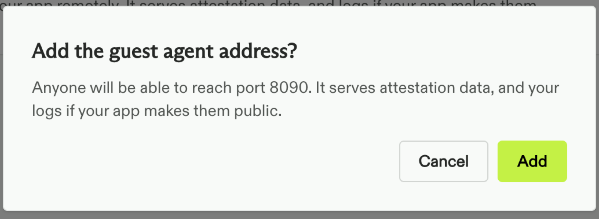

Every app has a guest agent on port 8090. It serves attestation data. If your app makes its logs public, it serves those too.

## Who can reach the guest agent

By default, only Phala Cloud can reach it. Dashboard logs and metrics keep working, because Phala Cloud is the one asking for them.

Open it to everyone only when others need to verify your app remotely. For example, the Trust Center or a third-party verifier needs to read the attestation data. If nobody outside needs that, leave it restricted.

## Open the guest agent

1. Open the dashboard, select your app, then select **Domains**.
2. Find the **Guest agent (port 8090)** row and select **Add**.
3. Read the confirmation. Anyone will be able to reach port 8090. Select **Add** to continue.

<Frame caption="The confirmation before the guest agent address is added">
  
</Frame>

The address appears in the list as `<app_id>-8090.<gateway domain>`. Share it with the people who need to verify your app.

## Restrict it again

1. On the **Domains** page, find the guest agent row.
2. Open its **⋯** menu and select **Restrict**.

Restricting blocks new connections. It also closes connections that are already open. The change takes effect within seconds on running instances.

## Choose at launch

Yes. The launch form has a **Restrict guest agent to Phala Cloud** switch. Turn it on to keep the guest agent restricted from the first start, or turn it off to open it. You can change the choice later on the **Domains** page.

## Next steps

- [Verify your app with the Trust Center](/phala-cloud/attestation/trust-center-verification)
- [Set up a custom domain](/phala-cloud/networking/setup-custom-domain)
