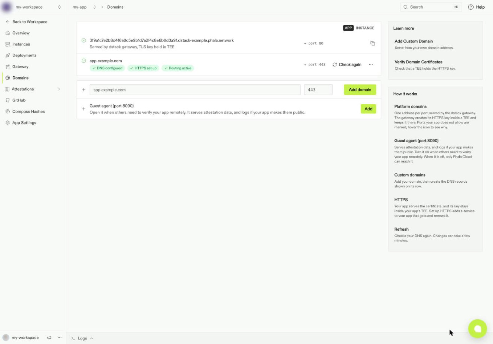
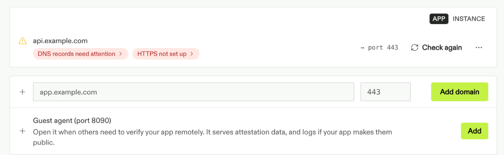
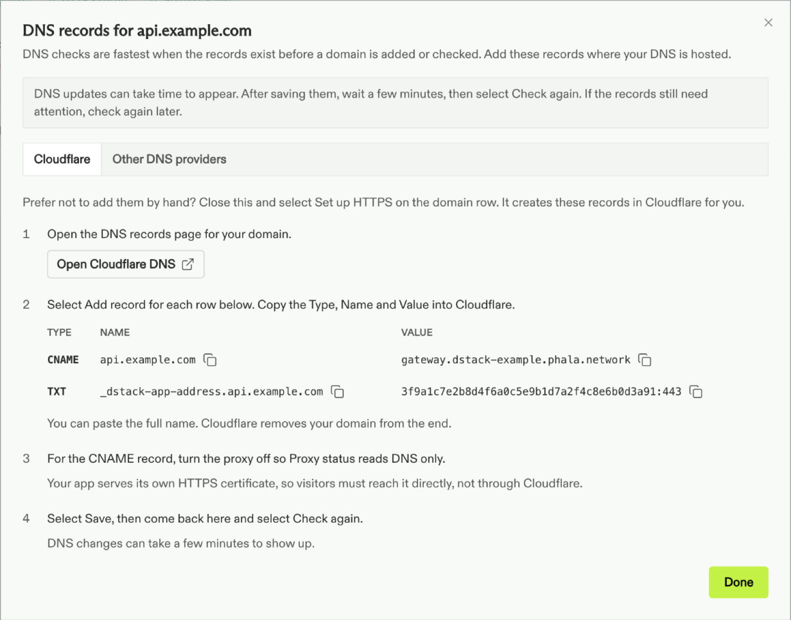
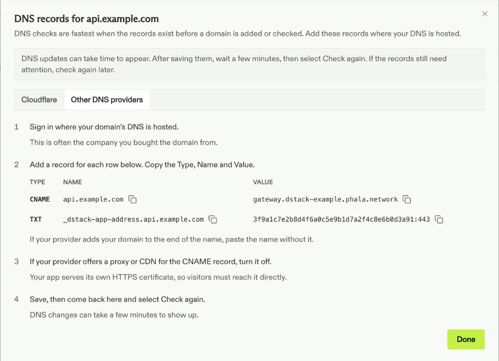
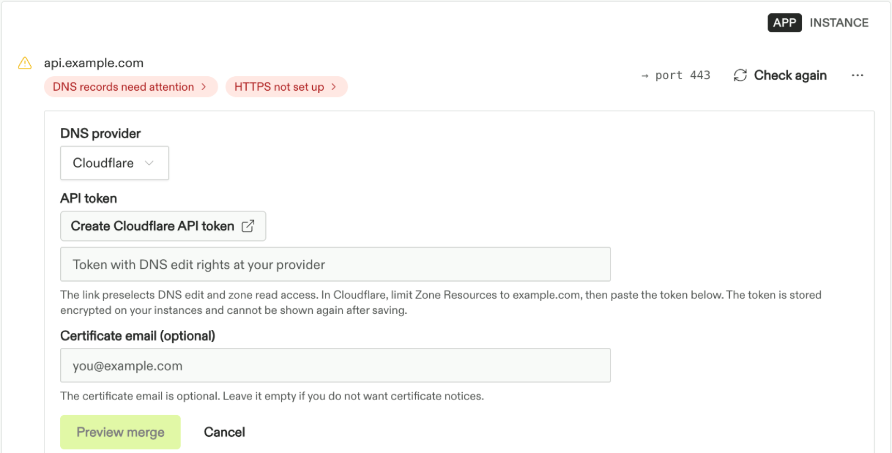

This guide shows you how to serve your app from your own domain, such as `api.mycompany.com`, instead of the default Phala Cloud address.

Every app already has a Phala Cloud address for each published port. The dstack gateway serves it, and the HTTPS key is held inside a TEE. A custom domain works the same way, with one difference. Your own app gets the certificate from Let's Encrypt, inside its TEE, so the key never leaves it. This is why the setup has two parts: DNS records that point your domain to the app, and a small service in your app that gets and renews the certificate.

You do both from the **Domains** page. Open the dashboard, select your app, then select **Domains**.

<Frame caption="The Domains page with a platform address and a configured custom domain">
  
</Frame>

## Prerequisites

- A deployed app on Phala Cloud
- A domain whose DNS you can edit
- For the dashboard flow, an API token from your DNS provider. Cloudflare has a ready-made token link. Other providers can use the [docker-compose method](#set-up-with-docker-compose)

## Add a custom domain

1. Open **Domains** for your app.
2. Type your domain, for example `api.example.com`. The port defaults to `443`. Change it only if your app serves HTTPS on another port.
3. Select **Add domain**.

The domain appears in the list with three status pills.

| Pill | Red | Green |
| --- | --- | --- |
| DNS | DNS records need attention | DNS configured |
| HTTPS | HTTPS not set up | HTTPS set up |
| Routing | Shows a hint that routing is not active yet | Routing active |

A new domain usually starts with red DNS and HTTPS pills.

<Frame caption="A new domain with DNS and HTTPS both still to do">
  
</Frame>

Select **Check again** on a row to check its DNS again. The domain name is a link to `https://<your domain>`.

## Create the DNS records

Select the red **DNS records need attention** pill. A dialog lists the records for that domain, with a **Cloudflare** tab and an **Other DNS providers** tab.

There are exactly two records:

| Type | Name | Value |
| --- | --- | --- |
| CNAME | `<your domain>` | `gateway.<gateway base domain>` |
| TXT | `_dstack-app-address.<your domain>` | `<app_id>:<port>` |

The CNAME sends visitors to the dstack gateway. The TXT record tells the gateway which app and port the domain belongs to. The dialog fills in the real values and has a copy button for each one.

<Tabs>
  <Tab title="Cloudflare">
    <Frame caption="DNS records dialog, Cloudflare tab">
      
    </Frame>

    1. Select **Open Cloudflare DNS**.
    2. Select **Add record** for each row. Copy the type, name and value from the dialog. You can paste the full name, because Cloudflare removes your domain from the end.
    3. For the CNAME record, turn the proxy off so **Proxy status** reads **DNS only**.
    4. Select **Save**, go back to the dashboard and select **Check again**.

    The proxy must be off because your app serves its own HTTPS certificate. Visitors have to reach the app directly, not through Cloudflare.

    If you plan to use **Set up HTTPS** in the next section, you can skip this. It creates these records in Cloudflare for you.
  </Tab>

  <Tab title="Other DNS providers">
    <Frame caption="DNS records dialog, Other DNS providers tab">
      
    </Frame>

    1. Sign in where your domain's DNS is hosted. This is often the company you bought the domain from.
    2. Add a record for each row. If your provider adds your domain to the end of the name, paste the name without it.
    3. If your provider offers a proxy or CDN for the CNAME record, turn it off.
    4. Save, go back to the dashboard and select **Check again**.
  </Tab>
</Tabs>

DNS checks are fastest when the records exist before you add the domain or select **Check again**. DNS changes can take a few minutes to show up. Wait, then select **Check again**.

## Set up HTTPS

Select the red **HTTPS not set up** pill. A form opens on the row.

<Frame caption="The Set up HTTPS form">
  
</Frame>

1. Choose your **DNS provider**.
2. Select **Create Cloudflare API token**. It opens Cloudflare with DNS edit and zone read access already selected. Under **Zone Resources**, limit the token to your zone, create it, and paste it into **API token**.
3. Optional: enter a **Certificate email**. Let's Encrypt uses it for certificate notices. Leave it empty if you do not want them.
4. Select **Preview merge**.

The page adds a pinned dstack-ingress service to your app's compose file and shows you the result before anything changes. Read it, then deploy. The token is stored encrypted on your instances, and it cannot be shown again after you save it.

dstack-ingress runs inside your app's TEE. It gets a Let's Encrypt certificate there, so the private key never leaves the TEE. It can also set CAA records so that only your TEE can get certificates for the domain. See [Security features](#security-features). dstack-ingress is open source; its code and full configuration reference are in [dstack-examples](https://github.com/Dstack-TEE/dstack-examples/tree/main/custom-domain/dstack-ingress).

The first deployment usually takes 3 to 5 minutes.

## Check that it works

Go back to **Domains** and select **Check again**. When the row shows **DNS configured**, **HTTPS set up** and **Routing active**, open `https://<your domain>`. Your browser should show a valid Let's Encrypt certificate.

To check that the certificate key is held by a TEE, follow [Domain attestation](/phala-cloud/networking/domain-attestation).

## Platform addresses and the guest agent

The first rows on the Domains page are the platform domains. There is one per published port. Use the **APP** and **INSTANCE** switch to see app-level addresses or the address of each instance.

A separate row controls the guest agent on port 8090. See [Guest agent access](/phala-cloud/networking/guest-agent-access).

## Set up with docker-compose

Use this method if you want to write the dstack-ingress service yourself, or your DNS provider is not in the dashboard form. It does the same job as **Set up HTTPS**. You edit the compose file and set the secrets by hand. The [dstack-ingress README](https://github.com/Dstack-TEE/dstack-examples/tree/main/custom-domain/dstack-ingress) lists every environment variable and more examples.

### Step 1: Create a DNS API token

<Tabs>
  <Tab title="Cloudflare">
    1. Go to your [Cloudflare Dashboard](https://dash.cloudflare.com/)
    2. Open **My Profile** → **API Tokens** and select **Create Token**
    3. Start from the **Edit zone DNS** template
    4. Make sure the token has **Zone → DNS → Edit** and **Zone → Zone → Read**
    5. Under **Zone Resources**, select only your domain's zone
    6. Select **Continue to summary**, create the token and copy it
  </Tab>

  <Tab title="Linode">
    1. Go to [Linode Cloud Manager](https://cloud.linode.com/)
    2. Click on your profile → **API Tokens**
    3. Create a **Personal Access Token** with Read/Write access to Domains
    4. Copy the token for later use
  </Tab>

  <Tab title="Namecheap">
    1. Enable API access in your [Namecheap account](https://www.namecheap.com/myaccount/login/)
    2. Go to **Profile → Tools → API Access**
    3. Note your username and API key
  </Tab>
</Tabs>

### Step 2: Add dstack-ingress to your deployment

Update your `docker-compose.yml` to include the dstack-ingress container:

```yaml
services:
  dstack-ingress:
    image: dstacktee/dstack-ingress:2.2@sha256:d05a7b343c37c1cca1bba8dbf7e8f3c6d2118158af2d41c455103796db4f67f0
    ports:
      - "443:443"
    environment:
      - DOMAIN=api.mycompany.com  # Your custom domain
      - TARGET_ENDPOINT=app:80  # Your app's internal endpoint
      - CLOUDFLARE_API_TOKEN=${CLOUDFLARE_API_TOKEN}
      - GATEWAY_DOMAIN=gateway.${DSTACK_GATEWAY_DOMAIN}
      - SET_CAA=true
    volumes:
      - /var/run/dstack.sock:/var/run/dstack.sock
      - /var/run/tappd.sock:/var/run/tappd.sock
      - cert-data:/etc/letsencrypt
      - evidences:/evidences
    restart: unless-stopped

  app:
    image: your-app:latest  # Your application
    volumes:
      - evidences:/evidences:ro
    # No ports exposed here - dstack-ingress handles external access

volumes:
  cert-data:  # Persistent storage for SSL certificates
  evidences:  # Generated attestation evidence files
```

Set `DOMAIN` to your custom domain and `TARGET_ENDPOINT` to your app's internal endpoint. `TARGET_ENDPOINT` tells dstack-ingress where to forward incoming traffic:

- `app:80` - Forward to service named "app" on port 80
- `api:3000` - Forward to service named "api" on port 3000
- `http://app:80` and `grpc://app:50051` are also accepted, but the protocol prefix is stripped before proxying
- Use the service name from docker-compose, not localhost

<Note>
`dstack-ingress` is a HAProxy-based L4/TCP proxy. It terminates TLS and forwards the TCP stream to `TARGET_ENDPOINT`; it does not apply Nginx-style HTTP redirects, header rules, body limits, or buffering settings. Put HTTP-specific behavior in your application or in a separate HTTP proxy behind `TARGET_ENDPOINT` if needed.
</Note>

<Warning>
  `GATEWAY_DOMAIN` becomes your domain's CNAME target, and its first label must
  start with a letter or digit. Android rejects a leading underscore, so the
  older `_.${DSTACK_GATEWAY_DOMAIN}` form resolves everywhere except Android —
  change it to `gateway.${DSTACK_GATEWAY_DOMAIN}` if your deployment still has it.
</Warning>

### Step 3: Configure environment variables

In the Phala Cloud dashboard, add these encrypted secrets. You can also add `CERTBOT_EMAIL` and reference it in the compose file as `CERTBOT_EMAIL=${CERTBOT_EMAIL}`. It is optional. Let's Encrypt uses it for certificate notices.

<Tabs>
  <Tab title="Cloudflare">
    - `CLOUDFLARE_API_TOKEN`: Your API token from Step 1
  </Tab>

  <Tab title="Linode">
    - `LINODE_API_TOKEN`: Your API token from Step 1
  </Tab>

  <Tab title="Namecheap">
    - `NAMECHEAP_USERNAME`: Your Namecheap username
    - `NAMECHEAP_API_KEY`: Your API key from Step 1
    - `NAMECHEAP_CLIENT_IP`: Your whitelisted IP address
  </Tab>
</Tabs>

### Step 4: Deploy

Deploy your updated docker-compose.yml through the dashboard. The first deployment typically takes 3–5 minutes as it:

1. Configures DNS records
2. Requests SSL certificate from Let's Encrypt
3. Starts the HAProxy TCP proxy

### Step 5: Verify

After deployment, you can:

1. **Access your domain**: Visit `https://api.mycompany.com`
2. **Check certificate**: Your browser should show a valid Let's Encrypt certificate
3. **Verify evidence**: Visit `https://api.mycompany.com/evidences/` to see attestation data

## Multiple Custom Domains

You can route multiple custom domains from one ingress container by using `DOMAINS` and `ROUTING_MAP`:

```yaml
services:
  ingress:
    image: dstacktee/dstack-ingress:2.2@sha256:d05a7b343c37c1cca1bba8dbf7e8f3c6d2118158af2d41c455103796db4f67f0
    ports:
      - "443:443"
    environment:
      DNS_PROVIDER: cloudflare
      CLOUDFLARE_API_TOKEN: ${CLOUDFLARE_API_TOKEN}
      GATEWAY_DOMAIN: gateway.${DSTACK_GATEWAY_DOMAIN}
      SET_CAA: true
      DOMAINS: |
        app.mycompany.com
        api.mycompany.com
      ROUTING_MAP: |
        app.mycompany.com=frontend:3000
        api.mycompany.com=api:8080
    volumes:
      - /var/run/dstack.sock:/var/run/dstack.sock
      - /var/run/tappd.sock:/var/run/tappd.sock
      - cert-data:/etc/letsencrypt
      - evidences:/evidences
    restart: unless-stopped

  api:
    image: my-api:latest
    volumes:
      - evidences:/evidences:ro
  
  frontend:
    image: my-frontend:latest
    volumes:
      - evidences:/evidences:ro

volumes:
  cert-data:
  evidences:
```

## Why We Pin Infrastructure Images

The dstack-ingress image uses a SHA256 hash instead of a tag. You can audit the code behind it in [dstack-examples](https://github.com/Dstack-TEE/dstack-examples/tree/main/custom-domain/dstack-ingress). Pinning ensures:

- **Auditability**: Anyone can verify the exact infrastructure code handling domains
- **Immutability**: The ingress behavior never changes unexpectedly
- **Security**: Prevents infrastructure image substitution
- **Reproducibility**: Domain handling is consistent across all deployments

## Security Features

When `SET_CAA=true` is enabled:

- CAA records restrict certificate issuance to the TEE managed Let's Encrypt account
- Only certificates requested from within your TEE can be issued
- Certificate transparency logs can be monitored for unauthorized certificates

<Warning>
**Cloudflare Users**: Cloudflare automatically overrides CAA records at the apex domain (e.g., `example.com`). This prevents domain attestation from working correctly.

**Solution options:**

1. **Use a subdomain** (recommended): Deploy to `app.example.com` instead of `example.com`
2. **Disable Cloudflare's CAA management**: See [Cloudflare CAA documentation](https://developers.cloudflare.com/ssl/edge-certificates/caa-records/#caa-records-added-by-cloudflare)

**To verify your CAA record is working:**

```bash
dig @1.1.1.1 +short CAA your-domain.com
```

Should return the Let's Encrypt account URI with `validationmethods=dns-01;accounturi=...`
</Warning>

## Troubleshooting

### DNS records need attention right after I added the domain

DNS changes can take a few minutes to show up, and the check may run before they do. Wait a few minutes, then select **Check again**. If the pill stays red, open it and compare each record with the dialog. Common causes:

- The name or value was pasted with a typo, or with your domain added twice.
- The CNAME proxy is still on. Turn it off so Cloudflare reads **DNS only**.
- The TXT record is missing. The domain needs both records.

### Routing is not active yet

The row shows a hint instead of **Routing active** until the gateway sees both DNS records and your app is serving the domain. Check that DNS reads **DNS configured**, then check that HTTPS reads **HTTPS set up**. If you just deployed, wait a few minutes and select **Check again**.

### The Set up HTTPS preview fails or the certificate is not issued

Check that the API token has DNS edit and zone read access, and that **Zone Resources** includes the zone for your domain. Create a new token with **Create Cloudflare API token** if you are not sure.

### Check Logs

Look for dstack-ingress container logs in the dashboard:

```text
Successfully received certificate.
Generated evidences successfully
Next renewal check in 12 hours
```

### Certbot Error: "too many certificates (5) already issued for this exact set of identifiers"

You may have forgotten to attach the data volume.

### Other Common Issues

**DNS not propagating**: Wait 2-5 minutes for DNS changes to propagate globally.

**Certificate request failed**: Verify your API token has permission to edit DNS records and read the zone.

**Connection refused**: Ensure `TARGET_ENDPOINT` points to the correct service:port.

**CAA record conflicts**: Some providers (like Linode) don't allow CAA and CNAME on the same subdomain. The system will automatically use A records instead.

## Next Steps

- [Control access to the guest agent on port 8090](/phala-cloud/networking/guest-agent-access)
- [Expose TCP services](/phala-cloud/networking/expose-tcp-service)
- [Learn about domain attestation](/phala-cloud/networking/domain-attestation)
- [Set up gRPC with custom domain](/phala-cloud/networking/setup-grpc-service)
- [dstack-ingress source and configuration reference](https://github.com/Dstack-TEE/dstack-examples/tree/main/custom-domain/dstack-ingress)
