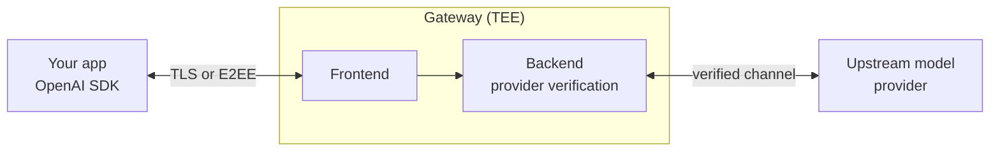

The platform runs inference behind an **Attested Confidential Inference (ACI)** gateway. The gateway is a
workload running inside a Trusted Execution Environment (TEE, Intel TDX). It does two things a normal
API cannot:

1. It proves which code is running, in a real TEE, with an **attestation report**.
2. It signs a **per-response receipt** that ties your exact request and response to that attested
   workload.

You do not have to trust the platform's word. You fetch these artifacts and check the signatures and
hashes yourself. This page explains the model. To run the checks, see
<a href={site.paths.verify}>Verify a response</a>.

## The two proof layers

<CardGroup cols={2}>
  <Card title="Attestation report" icon="microchip" href={site.paths.attestation}>
    Proves the gateway is a specific workload running in a genuine TEE, and publishes the keys it
    signs with. Fetch it from `GET /v1/aci/attestation?nonce=`.
  </Card>
  <Card title="Signed receipt" icon="receipt" href={site.paths.receipts}>
    Proves what the gateway received and returned for one request, signed by a key from the attested
    report. Fetch it from `GET /v1/aci/receipts/{id}`.
  </Card>
</CardGroup>

The report answers "who served me?". The receipt answers "what did they do with my request?". A
receipt is only meaningful once you have verified the report, because the report is what tells you
the receipt's signing key is bound to a genuine TEE.

## Request flow

1. You call the API over TLS, or add <a href={site.paths.e2ee}>E2EE</a>
   for field-level encryption.
2. The gateway records your request and computes its hash.
3. For confidential serving, the backend verifies the upstream provider and enforces a
   <a href={site.paths.upstreams + "#channel-binding"}>channel binding</a> before forwarding. If it cannot, it does not
   send your prompt (fail-closed).
4. The response returns through the gateway, which signs the receipt after it has observed the final
   response bytes.

On a TEE-only endpoint, every admitted inference request requires verified serving. On an endpoint
that also serves non-TEE models, require `provider.aci_verified: true` or session pins to prevent an
unverified routed provider from serving the request. The catalog’s `is_tee` flag alone does not
prove how a response was served.

## What you can verify

After one request you hold enough to check, locally:

- The gateway is a genuine TEE workload with a known identity (attestation report).
- The receipt was signed by a key that report endorses.
- The signed request hash matches the request you sent, and the signed response hash matches the
  response you received.
- For a confidential model, the upstream was verified and the channel was bound before your prompt
  was forwarded.

Continue with the concept pages below, or jump to the hands-on
<a href={site.paths.verify}>Verify a response</a> guide.
